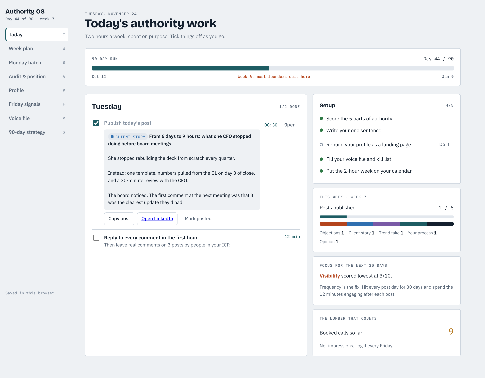

# Authority OS

**[How it works and how to track progress →](docs/GUIDE.md)** · [Test report](docs/TEST-REPORT.md)

A single-page app for running the "become the authority in your industry in 2 hours a week" playbook as a 90-day program.

## What's in it

- **Today**: what to do on each weekday (Monday batch, post days with 12 minutes of engagement, Friday signal check), plus setup progress and your 90-day run with the week-6 marker.
- **Week plan**: a 7-day board where every post is tagged with one of the 5 jobs (objections, client stories, trend takes, your process, opinions), a job-mix bar, and your schedule settings.
- **Calendar export**: downloads an `.ics` file with the weekly Monday batch block, post-day engagement slots, the Friday check for 13 weeks, a day-90 review, and every planned post.
- **Monday batch**: paste voice-note transcripts and turn them into the week's posts.
- **Audit & position**: score Expertise, Visibility, Association, Voice and Proof from 1 to 10, see your lowest, and build your "I help [ICP] fix [problem] without [the thing they hate]" sentence.
- **Profile**: rewrite banner, headline, Featured and About as a landing page, with suggestions drawn from your sentence.
- **Friday signals**: a 13-week log of ICP profile views, ICP followers, inbound leads, booked calls, pipeline and impressions, with a chart of calls against impressions.
- **Voice file**: how you talk, phrases you use, and a kill list that flags banned words in every draft.
- **90-day strategy**: the three phases, the rules, and where the 2 hours go.

## Running it

Open `index.html` in a browser, or serve the repo with GitHub Pages. There's no build step and no dependencies beyond Google Fonts.

Data is saved in your browser's local storage as you type, so it stays on the device and browser you use. Use **Friday signals → Backup** to move it between computers. When the page runs as a Claude artifact, it saves to your Claude account instead and can draft posts with Claude; those two features are hidden when it runs on its own.

Keyboard shortcuts: T, W, B, A, P, F, V, S switch sections.

## Tests

`tests/e2e.py` runs the app end to end in headless Chromium with a simulated clock. Serve the repo first (`python3 -m http.server 8765`), then run `python3 tests/e2e.py`. It needs `playwright` and `icalendar`.
