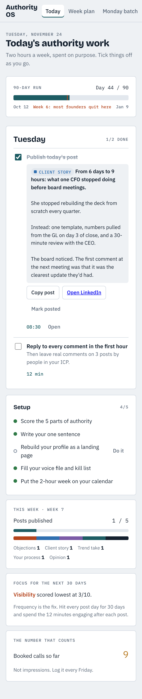
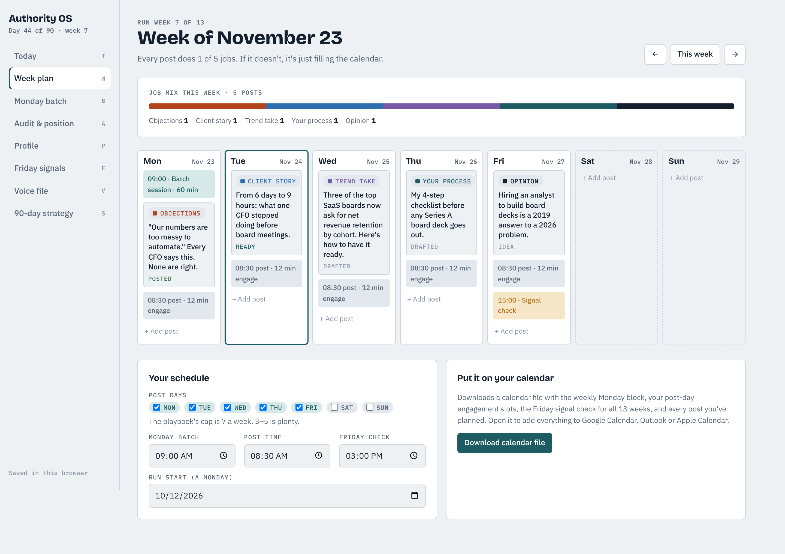
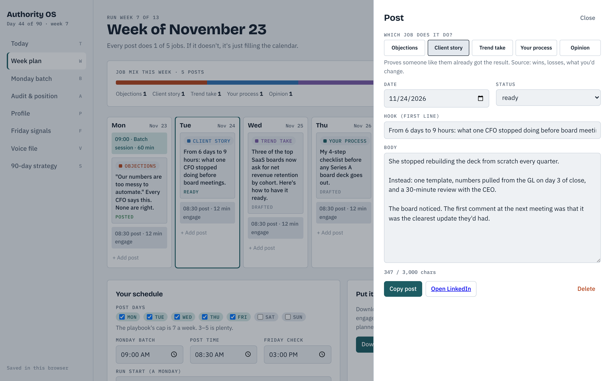
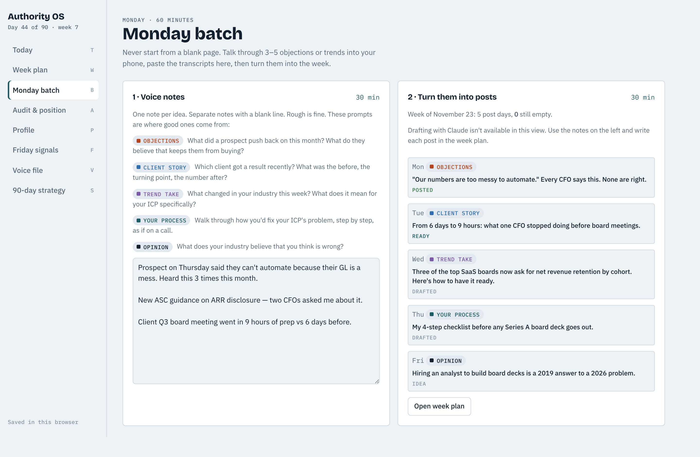
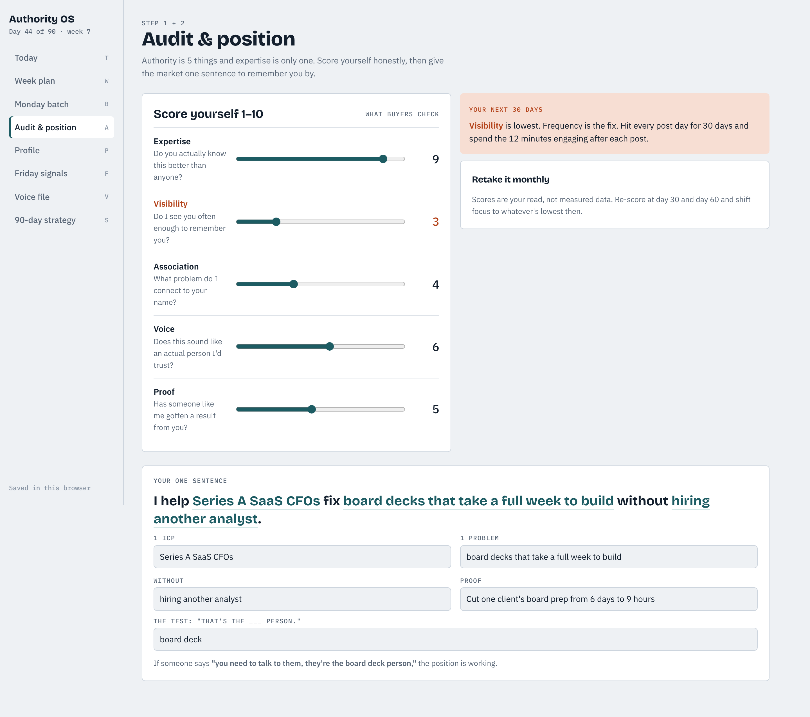
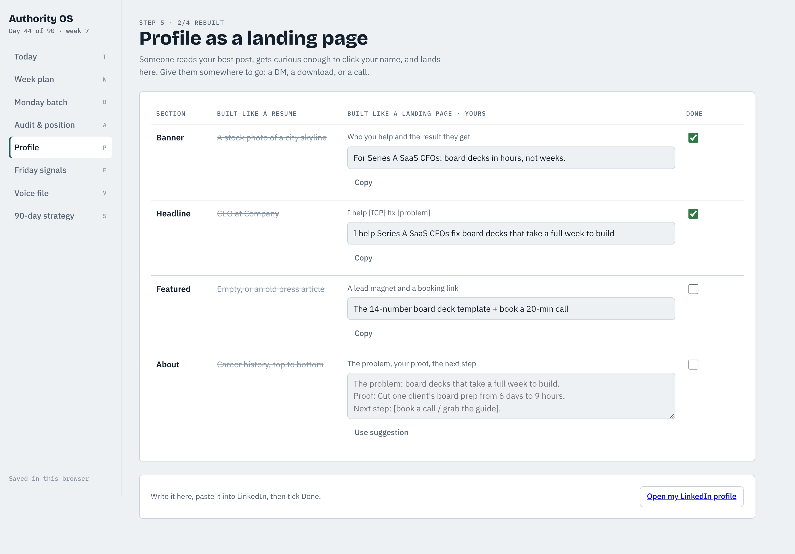
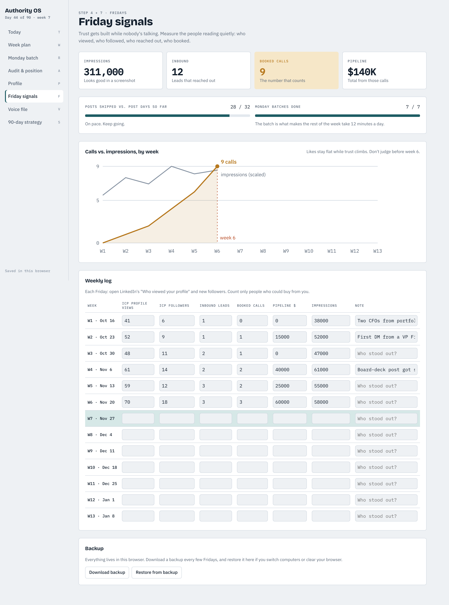
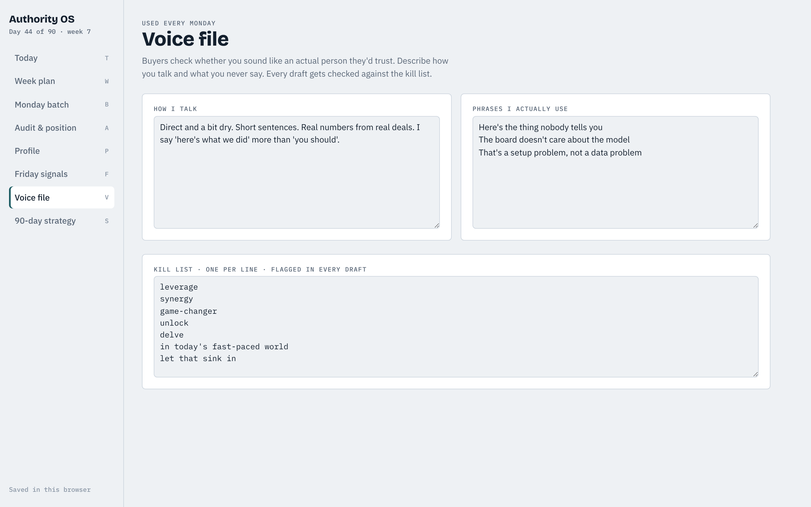
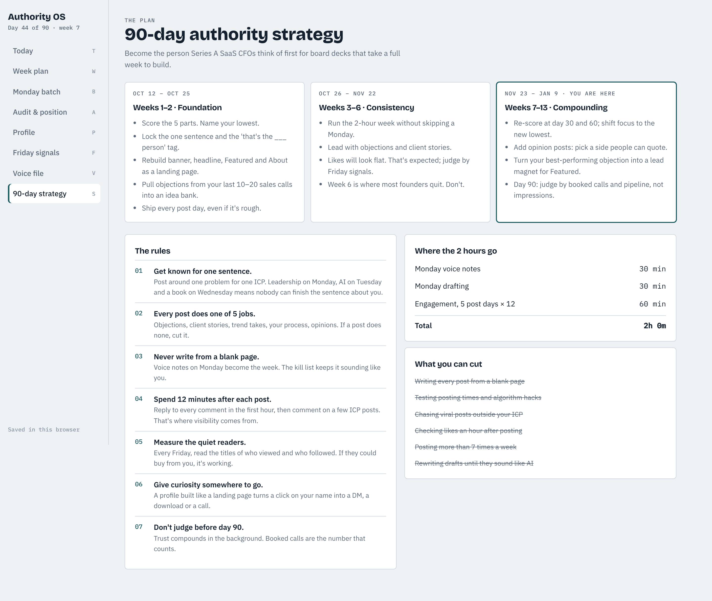

# How Authority OS works

Authority OS runs the "authority in 2 hours a week" playbook as a 90-day program. You set it up once, then each weekday tells you what to do, and every Friday you log the signals that show whether it's working.

The screenshots use example data for a founder who helps Series A SaaS CFOs with board decks, on day 44 of the run.

## The rhythm

| When | What you do | Time | Where in the app |
|---|---|---|---|
| Once, before day 1 | Score yourself, write your sentence, rebuild your profile, fill your voice file, export the calendar | ~1 hour | Today → Setup |
| Every Monday | Record voice notes on 3–5 objections or trends, then turn them into the week's posts | 60 min | Monday batch |
| Every post day | Publish, reply to every comment in the first hour, comment on a few ICP posts | 12 min | Today |
| Every Friday | Read who viewed your profile and who followed. Log the people who could buy from you | 10 min | Friday signals |
| Day 30 and day 60 | Re-score the 5 parts and shift focus to the new lowest | 15 min | Audit & position |
| Day 90 | Judge the run by booked calls and pipeline | 30 min | Friday signals |

## 1. Today

This is your home screen. It shows:

- **The 90-day run bar**, with the week-6 marker where most founders quit.
- **Today's tasks.** These depend on the day: batch tasks on Monday, the planned post plus the 12-minute engagement task on post days, and the signal check on Friday. Today's post is shown in full with **Copy post**, **Open LinkedIn** and **Mark posted**.
- **Setup progress.** This disappears once all 5 items are done.
- **This week:** posts published against your target, and the mix of post jobs.
- **Focus for the next 30 days:** your lowest-scoring part of authority and what to do about it.
- **Booked calls so far:** the number the playbook says actually counts.

It works on your phone too:

## 2. Week plan

Each day column shows the Monday batch block, your posts, your post-time engagement slot and the Friday signal check. Every post card shows its **job** and its **status**: idea → drafted → ready → posted.

The **job mix** bar at the top warns you when a post has no job, because a post with no job dilutes what people associate with you.

Below the board you set your post days and times and the run start date. **Download calendar file** gives you an `.ics` file you can open in Google Calendar, Outlook or Apple Calendar. It contains:

- A weekly 60-minute Monday batch block (13 weeks).
- A 12-minute engagement slot on every post day until day 90.
- A weekly Friday signal check (13 weeks).
- Re-score reminders on day 30 and day 60, and a day-90 review.
- Every post you've planned, with the full text in the event notes.

Click any post to edit it:

Pick the job, write the hook and body, and copy it straight to LinkedIn. Any word from your kill list is flagged as you type.

## 3. Monday batch

Paste your voice-note transcripts, one idea per paragraph. The prompts beside the notes box come from the 5 jobs, so you always have something to talk about.

When the app runs inside Claude, **Draft posts from my notes** writes one post for each empty post day this week. It uses your sentence, proof, voice file and kill list, and steers the mix toward the job that builds your weakest area. On the standalone site this button is hidden, and you write the posts in the week plan yourself.

## 4. Audit & position

Score Expertise, Visibility, Association, Voice and Proof from 1 to 10. The lowest score is highlighted and tells you where the next 30 days of content should go.

Then fill in **I help [1 ICP] fix [1 problem] without [the thing they hate]**, add your proof, and finish the "that's the ___ person" test. The sentence feeds the profile suggestions, the strategy page and the drafting prompt.

## 5. Profile

This page sets the four sections that matter (banner, headline, Featured, About) against how a resume-style profile handles them. Suggestions are built from your sentence. Write your version, paste it into LinkedIn, and tick **Done**.

## 6. Friday signals: tracking progress

This is where you track progress. Each Friday, fill in one row:

| Column | Where to get it |
|---|---|
| ICP profile views | LinkedIn → "Who viewed your profile". Count only people who could buy from you. |
| ICP followers | New followers this week, ICP only. |
| Inbound leads | DMs, emails or form fills from people who found you through content. |
| Booked calls | Calls on your calendar from those leads. |
| Pipeline $ | The value of opportunities from those calls. |
| Impressions | LinkedIn analytics, for context only. |

The page then shows:

- **Totals** for impressions, inbound leads, booked calls and pipeline. Booked calls is highlighted because it's the number that counts.
- **Consistency:** posts shipped against post days so far, and Monday batches done. If either slips, the page tells you to protect Monday's hour first.
- **Chart:** cumulative booked calls against weekly impressions, with week 6 marked. Impressions usually stay flat while calls climb.
- **Backup:** download your data as a file and restore it on another computer or after clearing your browser.

## 7. Voice file

Describe how you talk and list the phrases you actually use. The kill list starts with common AI and corporate filler. Add anything you'd never say.

## 8. 90-day strategy

The three phases (Foundation, Consistency, Compounding) are dated from your start and highlight where you are now. The page also shows the playbook's rules, where the 2 hours go based on your post days, and what to cut.

## Where your data lives

- **Standalone site (this repo / GitHub Pages):** in your browser's local storage. Nothing is sent anywhere. Changes save the moment you make them. Two open tabs stay in sync. Use **Friday signals → Backup** to move data between computers.
- **Inside Claude (as an artifact):** in your Claude account, so it follows you across devices. Claude drafting is available there.

Keyboard shortcuts: **T**oday, **W**eek, **B**atch, **A**udit, **P**rofile, **F**riday signals, **V**oice, **S**trategy.
